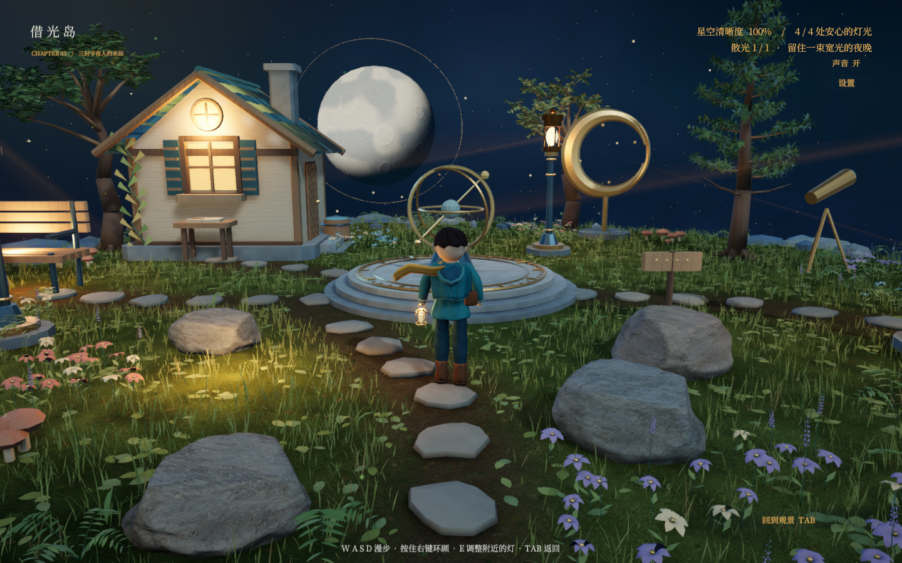

# 借光岛

《借光岛——把星空还给夜晚》是一款使用 Blender 与 Unity 制作的三维叙事解谜游戏。玩家调整三盏灯的朝向与光罩，在照亮小路、长椅、书窗和码头的同时控制溢光，让星空重新出现；也可以在岛上自由漫步。

这是当前开发快照。已有完整的三章游戏流程，人物形象和主线故事正在根据试玩反馈重新设计，尚未达到最终美术目标。已知稳定发布为 v13；当前 Unity 工程包含 v14 人物与灯光候选，以及默认不开启的视觉诊断代码。当前源代码不等同于此前任一个发行包。



## 克隆与打开

安装 Git LFS 后克隆，以取得实际模型和字体文件：

```powershell
git lfs install
git clone https://github.com/Obito1037/game.git
cd game
git lfs pull
```

使用 Unity Hub 打开 `GameProject/`，安装 **Unity 6.3 LTS 6000.3.26f1**。项目使用 URP；包版本由 `Packages/manifest.json` 和 `packages-lock.json` 固定。首次打开需等待 Package Manager 下载依赖和资源导入。

打开场景 `Assets/BorrowedLight/Scenes/BorrowedLight.unity` 并进入 Play 模式。工程内已经包含游戏运行所需模型、纹理、字体和声音，运行游戏不需要重新生成 Blender 资产。

Blender 制作环境为 **4.5.14 LTS**。Unity CLI 的实验版本为 `1.0.0-beta.13`，对应 `com.unity.pipeline` 为 `0.8.0-exp.1`；CLI 用于辅助制作，并非打开工程或游玩的前提。工具安装包不随仓库上传。

## 构建和操作

在 Unity 的 Build Profiles 中选择 Windows 或 Web 平台，并将上述游戏场景加入构建列表。输出可使用 `builds/windows/` 或 `builds/web/`。仓库不包含已编译玩家；现有 `.cmd` 游戏启动器在对应构建生成后使用。

项目也提供 `Borrowed Light/Build Windows Game` 和 `Borrowed Light/Build Web Game` 编辑器菜单。这两项会先重新创建场景并应用脚本中的项目设置；需要保持当前场景和设置时，请使用 Unity 原生 Build Profiles。

- `Enter`：开始旅程或推进已完成的章节。
- 观景模式：点击灯具选择，`A / D` 调整方向，空格切换光罩。
- `Tab`：切换自由漫步；`WASD` 移动，按住鼠标右键环顾，滚轮缩放。
- 漫步时按 `E`：调整附近的灯具。
- `Esc`：暂停与设置。

## 制作文件

| 路径 | 内容 |
| --- | --- |
| `GameProject/Assets/` | Unity 场景、程序、材质、模型及完整 `.meta` |
| `GameProject/Packages/`、`ProjectSettings/` | 包锁定和项目设置 |
| `art/blender/` | 场景、角色、声音与资产处理脚本 |
| `art/generated/` | 保留的 Blender 源文件、模型导出、纹理、字体及来源记录 |
| `art/design/redesign-brief.json` | 最新试玩反馈与待回答的设计问题 |
| `art/verification/` | 历史测试、制作审查、源码快照和少量实机截图 |
| `tools/`、`setup/` | 自写启动、打包、验收和环境检查脚本 |

当前世界模型源为 `art/generated/world-v12/island.blend`，当前开发角色源为 `art/generated/character-v11/traveler.blend`。世界生成链保留 world-v12、v10、v8、v7、v6，以及旧审核需要的 v5；角色生成需要的旧资产也随库保留。部分生成脚本校验旧版 BLEND、FBX 和 GLB 的哈希，因此这些文件不能随意替换或删除。

`character-v12`、`character-v13`、`character-v14` 是未采用的试验，`character-v15` 尚未生成成品；不要将编号更高视为已通过验收。world-v3、v4、v9、v11 的旧输出、Blender 自动备份、批量验收图片和视频留在本机，相关历史脚本或审查页面引用这些文件时，需要原本的本地归档。

环境脚本和部分浏览器验收脚本保留了原工作站路径。换机器后需调整工具位置并安装其依赖；字体子集工具的依赖见 `tools/font-subset/requirements.txt`。不要对生产资产直接运行旧试验脚本。

## 当前验证与后续工作

v14 灯光候选的 Windows 验收记录位于 `art/verification/run-035-v14/runtime-results.json`，包含完整通关、暂停、重开、漫步、已有碰撞与缩放检查。该记录对应当时的构建；后续新增的诊断代码不在这份正常玩法验收范围内。此前 v13 的 Windows 与 Web 验收记录分别位于 `run-033-v13/` 和 `web-014-v13/`。

用户试玩认可基本游戏体验，但明确要求重做人物审美并加强主线吸引力。新版必须符合社会主义核心价值观，具备情感和精神力量；目前等待完整设计问卷的回答，再确定创作方向。参考作品为 [小王子 星辰之旅](https://littleprince.dev/)，参考图片和网站代码没有作为游戏素材发布。

## 来源与使用说明

AI 辅助、原创制作过程及素材来源见根目录 `AI-使用与素材来源.zh-CN.txt`、各资产目录的 manifest 和 prompt。字体的 SIL OFL 许可证及子集说明随源文件和 Unity 字体保留。参赛说明草稿见 `SUBMISSION-演示与材料.zh-CN.txt`，尚不代表已经报名或完成提交。

本仓库没有为项目自有代码与美术指定开源许可证；公开可见不等于授予自由再分发许可。第三方素材分别遵循所附授权。
